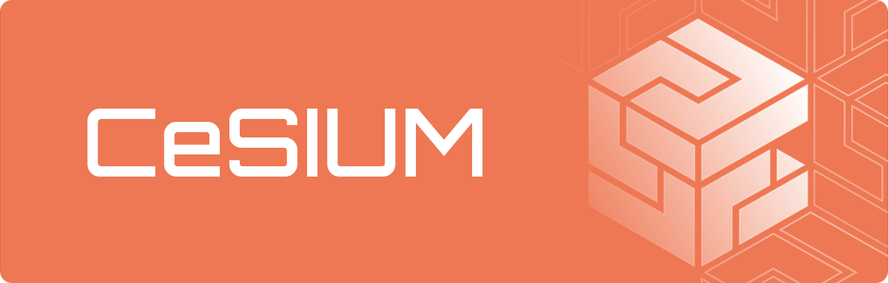

[contributing]: CONTRIBUTING.md
[code_of_conduct]: CODE_OF_CONDUCT.md
[license]: LICENSE.txt

# Hydrogen

Hydrogen is the landing page for [CeSIUM](https://cesium.di.uminho.pt/), Centro de Estudantes de Engenharia Informática da Universidade do Minho. Built with [Next.js](https://nextjs.org/) and [React](https://react.dev/), it is the place where students get to know CeSIUM, its team and departments, and find out how to become a member or collaborator.

It is also responsible for showcasing upcoming events synced from [Atlas](https://github.com/cesium/atlas), the partners and the discounts available to members, the merchandise from the [store](https://store.cesium.pt), and CeSIUM's official documents.

## 🤝 Contributing

When contributing to this repository, please first discuss the change you wish
to make via discussions, issue, email, or any other method with the owners of
this repository before making a change.

Please note we have a [Code of Conduct][code_of_conduct], please follow it
in all your interactions with the project.

We have a [Contributing Guide][contributing] to help you getting started.

## 📝 License

Copyright (c) 2026, CeSIUM.

This project is licensed under the MIT License - see the [LICENSE][license]
file for details.
